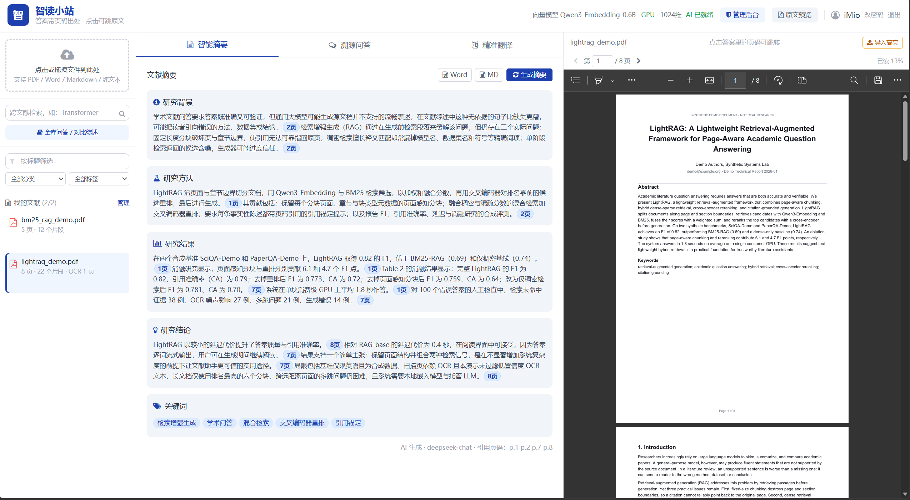
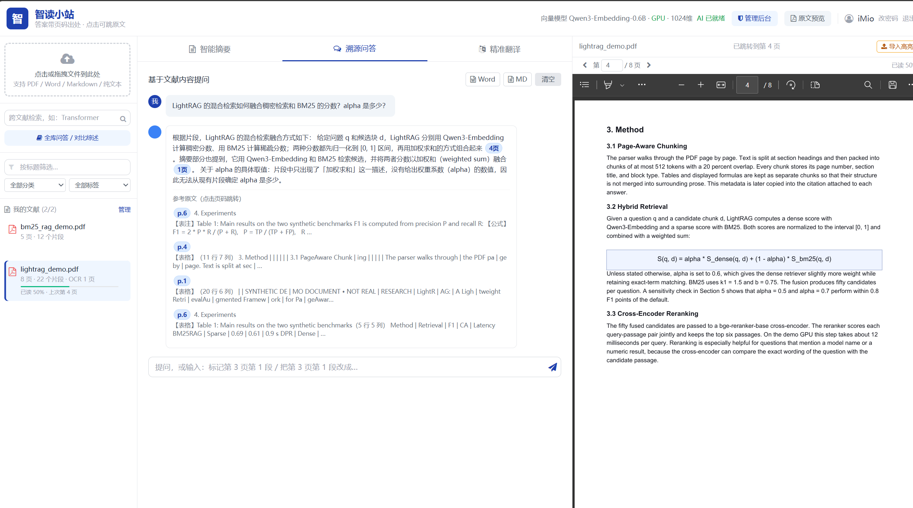
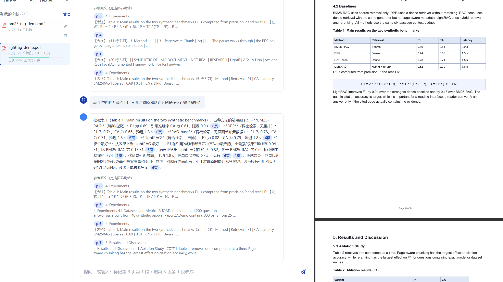
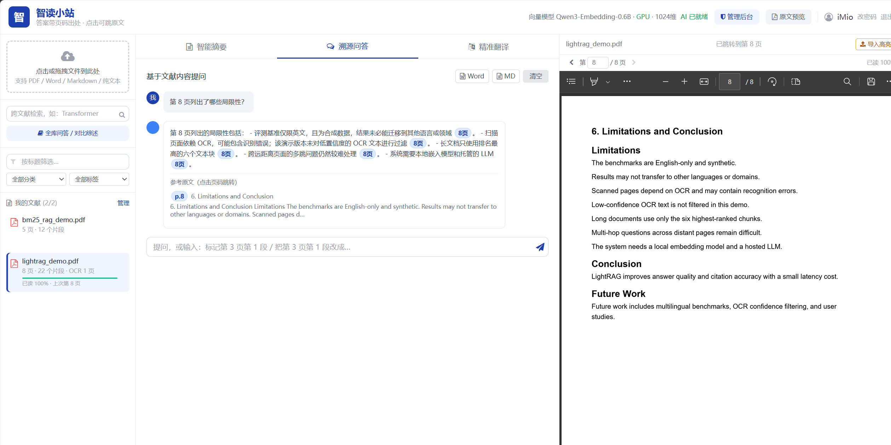
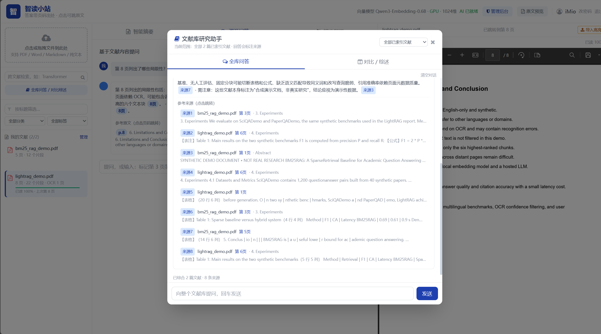
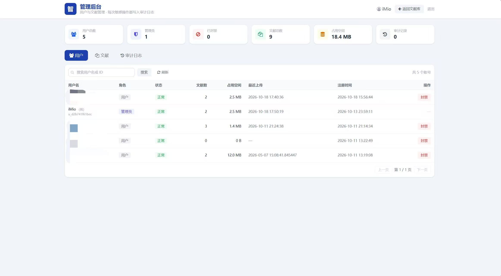
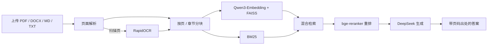

# 智读小站 - AI文献阅读助手

一个基于 Flask + 大模型的智能文献阅读工具。上传 PDF 后可以生成结构化摘要、基于文献内容提问、做学术翻译，
**所有 AI 生成的结论都会标注页码出处，点一下就能跳到原文对应页**。

## 🖼️ 界面预览

| 界面 | 界面 |
|---|---|
| **主界面：文献列表 + 原文对照**<br> | **溯源问答：答案带「第 4 页」出处**<br> |
| **表格与公式：引用表 1 并附页码**<br> | **OCR 扫描页：纯图片的第 8 页也能问答**<br> |
| **多篇对比：同时引用两篇论文**<br> | **管理后台：用户、封禁与审计日志**<br> |

> 更多界面（登录、注册、改密码）见 [docs/screenshots](docs/screenshots/)。

---

## ✨ 核心特性

| 特性 | 说明 |
|---|---|
| 📄 **多格式上传** | 支持 **PDF / Word(.docx) / Markdown(.md) / 纯文本(.txt)**，自动识别编码（UTF-8、GBK 都能读） |
| 🔍 **混合检索** | 向量语义检索（Qwen3-Embedding）+ BM25 关键词检索 + 词面重排，专有名词和术语也能命中 |
| 📝 **结构化摘要** | 研究背景 / 方法 / 结果 / 结论 / 关键词，流式输出，每句都带 `[[p.编号]]` 出处 |
| ❓ **溯源问答** | 基于文献片段作答，答案标注依据来自第几页/第几段，下方列出参考原文 |
| 📖 **按页问答** | 问「第 244 页讲了什么」时直接读取该页全部内容，不受语义检索召回限制；支持页码区间与越界提示 |
| 🌐 **学术翻译** | 术语级精准翻译，流式输出 |
| 🔐 **登录鉴权** | 账号密码登录，bcrypt 哈希 + 签名令牌，文献按账号隔离 |
| 🛡️ **管理后台** | 用户封禁/解封、违规文献删除、审计日志；查看原文需按篇授权且全程留痕 |
| 📑 **原文对照** | PDF 用浏览器原生阅读器跳到第 N 页；Word/文本类没有"页"，右侧改成渲染正文，点出处滚动定位并高亮那一段 |

---

## 📁 项目结构

```
dachuang/
├── README.md                    # 本文件
├── index.html                   # 前端页面（单文件）
├── admin.html                   # 管理后台（用户/文献/审计）
├── 启动.bat                     # Windows 一键启动
├── vendor/                      # 前端依赖的本地副本（离线可用，不依赖国外 CDN）
│   ├── js/tailwind.js
│   ├── css/font-awesome.min.css
│   └── fonts/…
├── docs/
│   ├── 安装文档.md              # 新机器部署步骤（含模型下载）
│   └── 升级说明.md              # v2 升级的技术细节与实测数据
├── tests/                       # 自测脚本
│   ├── e2e_test.py              # 后端端到端测试（41 项）
│   ├── check_frontend.py        # 前端语法与结构检查
│   ├── test_render.py           # 前端渲染逻辑单测
│   └── reset_state.py           # 把项目恢复到"还没注册过"的干净状态
├── samples/                     # 演示用虚构论文 + 提问脚本
└── backend/
    ├── app.py                   # 后端主程序：路由、鉴权、流式接口
    ├── config.py                # 集中配置（路径、模型、检索参数、离线开关）
    ├── auth.py                  # 账号与会话（bcrypt 密码 + 签名令牌）
    ├── admin.py                 # 管理后台：审计日志、按篇授权、权限装饰器
    ├── manage.py                # 管理员命令行（create-admin / list-users）
    ├── embeddings.py            # 向量模型服务（全局单例，失败会显式报错）
    ├── retrieval.py             # 按页解析、带页码分块、混合检索、重排
    ├── documents.py             # 文档存储 + 后台建索引任务
    ├── llm_integration.py       # 大模型调用（摘要/问答/翻译，均支持流式）
    ├── ai_functions.py          # 兼容层，保留旧接口名
    ├── requirements.txt         # Python 依赖
    ├── .env.example             # 环境变量模板
    ├── .env                     # 你的 API 配置（不要分享！）
    ├── data/                    # 账号数据、会话密钥（自动生成）
    └── uploads/
        └── <用户ID>/            # 每个账号的文献互相隔离
```

---

## 🖥️ 环境要求

- **Python 3.9+**（开发环境用的是 3.13）
- **内存 8GB 以上**
- **可选但强烈建议：NVIDIA 显卡 + CUDA 版 torch**
  建索引速度差距极大：一篇 100 段的论文，CPU 要 12~35 分钟，显卡只要 **4 秒**。
  程序会自动检测，没有显卡就退回 CPU，不用改代码。

> 没有显卡也可以跑，只是建索引慢一些；程序会自动检测设备并回退到 CPU。
> CUDA 版 torch 与 Python 版本强绑定，安装失败时按 PyTorch 官网挑选对应版本即可。

---

## 🚀 快速启动

### 第一步：安装依赖（首次使用）

```bat
cd backend
pip install -r requirements.txt
```

有 NVIDIA 显卡的话，再补一条（强烈建议）：

```bat
pip install torch --index-url https://download.pytorch.org/whl/cu128
```

### 第二步：配置大模型 API

1. 进入 `backend/` 目录
2. 复制 `.env.example` 为 `.env`
3. 填入你的 API Key：

```
OPENAI_API_KEY=你的key
OPENAI_BASE_URL=https://api.deepseek.com/v1
OPENAI_MODEL=deepseek-chat
```

> 不填也能启动，但摘要/问答/翻译会明确报"大模型不可用"，不会假装成功。

### 第三步：启动

双击根目录的 **`启动.bat`**，会自动打开浏览器到 http://127.0.0.1:5000

手动启动：

```bat
cd backend
python app.py
```

> ⚠️ **请通过 http://127.0.0.1:5000 使用**，不要直接双击 `index.html`。
> 从文件打开时登录状态只能靠浏览器本地存储，且部分浏览器会拦截，体验不完整。

---

## 👤 账号说明

- 首次使用点「注册」创建账号，密码至少 6 位
- **用户名只能由字母和数字组成**（2~32 位，不支持中文、空格、下划线等）
- **第一个注册的账号会自动继承升级前上传的文献**（会提示继承了几个文件）
- 每个账号只能看到、删除自己上传的文献
- 右上角点「改密码」可以随时修改密码：**改完其它设备上的登录状态会立即失效**（当前窗口不受影响）
- 登录状态默认保持 7 天

---

## 💡 使用说明

1. **上传文件**：点左侧区域选择文件。支持 PDF、Word(.docx)、Markdown(.md)、纯文本(.txt)；
   上传后会在后台建立语义索引，左侧显示实时进度
2. **生成摘要**：选中文献后点「生成摘要」，内容流式出现
3. **看出处**：答案里的蓝色 `3页` / `3段` 按钮就是出处
   - PDF：点一下右侧原文跳到第 3 页
   - Word / Markdown / 文本：点一下右侧正文滚动到第 3 段并高亮
4. **问答**：切到「溯源问答」，输入问题，答案下方会列出参考原文片段
5. **按页提问**：直接问「第 244 页讲了什么」「第 3 页到第 5 页的方法」；系统会读取指定页的全部文字，
   不再受语义检索召回范围影响。超出总页数会明确提示
6. **管理后台**：管理员账号登录后，页面顶部出现「管理后台」入口，可封禁用户、删除违规文献、查看审计日志。
   默认只能看到文献元数据；核查举报时需填写原因按篇授权，授权有效期 10 分钟，且每次打开都写入审计日志

---

## 🎬 演示素材

`samples/` 下提供两篇**虚构的演示论文**和一份提问脚本，覆盖摘要、溯源问答、表格/公式、指定页码、OCR 扫描页、学术翻译和多篇对比：

- [samples/README.md](samples/README.md) —— 演示步骤、预期答案和截图清单
- [lightrag_demo.pdf](samples/lightrag_demo.pdf) —— 8 页主论文，第 8 页是纯图片扫描页（触发 OCR）
- [bm25_rag_demo.pdf](samples/bm25_rag_demo.pdf) —— 5 页对照论文，用于全库检索与多篇比较

---

## 🔧 常见问题

| 现象 | 原因与处理 |
|---|---|
| 页面顶部显示「模型未加载」 | 本机 HuggingFace 缓存里没有 `Qwen/Qwen3-Embedding-0.6B`，需要先联网下载一次模型 |
| 左侧文献一直显示「建立索引」且很慢 | 正在用 CPU 跑向量模型。装 CUDA 版 torch 可提速约 200 倍 |
| 摘要/问答提示「大模型不可用」 | `backend/.env` 没配好 API Key，或 Key 失效 |
| 上传提示「提取不到有效文字」 | 这张 PDF 是扫描件（图片型），需要先做 OCR |
| 上传 `.doc` 被拒绝 | 只支持新版 `.docx`。老版 `.doc` 是二进制格式，请用 Word 另存为 `.docx` |
| 登录页背景动得太快/太慢 | 改 `index.html` 里的 `BG_SPEED`：0.6 更快，1.5 更慢，改完刷新即可 |
| 想重新体验首次注册流程 | 先停服务，执行 `python tests/reset_state.py` 看预演，确认后加 `--force`（⚠️ 会删掉现有账号） |

---

## 🧪 自测

服务启动后，另开一个终端：

```bat
python tests/e2e_test.py          # 后端 41 项端到端测试
python tests/check_frontend.py    # 前端语法与结构检查
python tests/test_render.py       # 前端引用渲染逻辑单测（需要 node）
```

---

## 📤 分享给朋友

只需要给两样东西：

| 给什么 | 怎么给 | 大小 |
|---|---|---|
| **项目文件夹** | 压缩后发微信/QQ | 4 MB（不含文献与模型） |
| **安装文档** | [docs/安装文档.md](docs/安装文档.md) | 16 KB |

朋友拿到后，**把安装文档全文丢给他的 AI 助手**，AI 会照着体检、判断该装什么、
该复用本机哪些东西，然后一步步装完。**不需要 U 盘，所有东西他自己下。**

### 朋友那边要下什么

| 要装的 | 大小 | 从哪下 | 实测情况 |
|---|---|---|---|
| CUDA 版 torch | 2.6 GB | PyTorch 官方源 | 慢（实测 0.5~24 MB/s 不定），**断了重跑即可续传** |
| 向量模型 | 1.15 GB | **ModelScope 魔搭** | ✅ **实测 40 秒下完（24 MB/s）** |
| 其余 Python 库 | 350 MB | 阿里云 PyPI 镜像 | 快，1 分钟 |

> 模型**必须**用文档里的脚本从 ModelScope 下。实测让 `huggingface_hub` 走
> hf-mirror 会失败（报 `FileMetadataError`），这条路是坏的。

### ⚠️ 发之前必须删掉这三样

否则你的账号、文献、API Key 会一起被发出去（这三个路径已写进 `.gitignore`，但打包压缩时要自己确认）：

- `backend\.env` —— 你的 API Key
- `backend\data\` —— 账号、密码哈希与签名密钥
- `backend\uploads\` —— 所有已上传文献

---

## 🧱 技术实现



- **检索链路**：PDF 按页解析 → 带页码分块 → Qwen3-Embedding 向量索引（FAISS）+ BM25 → bge-reranker 重排 → 带出处生成
- **扫描件兜底**：RapidOCR 自动补齐图片页文字，OCR 开关与阈值可配置
- **流式输出**：摘要、问答、翻译均走 SSE，前端边收边渲染
- **鉴权**：bcrypt 密码哈希 + itsdangerous 签名令牌；封禁后旧令牌在下一次请求即失效
- **管理后台的隐私模型**：默认只返回文献元数据；核查举报时按篇签发 10 分钟授权，签发与每次打开都写审计日志；
  越权访问、伪造令牌、路径穿越均有测试覆盖
- **测试**：41 项后端端到端测试 + 前端语法与渲染检查

---

## 📚 技术文档

- 本次升级的技术细节与实测数据：[docs/升级说明.md](docs/升级说明.md)
- 后端 API 文档：[backend/README.md](backend/README.md)
